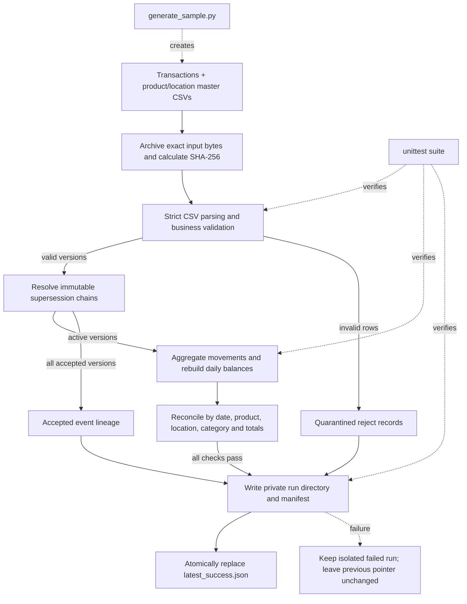

# Inventory Balance Pipeline

A local Python pipeline that validates inventory movements, rebuilds daily stock balances, preserves correction history, and publishes traceable reconciliation reports.

## Requirements and quick start

- Python 3.10 or newer
- Python standard library only; no database or external service is required

From the project folder, run:

```sh
python src/main.py
python -m unittest discover -s tests -v
```

The sample contains 9 transaction rows: 6 accepted event versions and 3 rejected rows. The expected daily output has 12 rows. The sample's ending company stock is 12 and its reconciliation difference is 0.

## Outputs

Every run is written into its own directory under `data/output/runs/<run_id>/`. The pipeline writes `data/output/latest_success.json` only after the full output set has been prepared. Consumers should follow this pointer and read all artifacts from the referenced run directory.

A successful run contains:

- `daily_balances.csv` — one row per date, product, and location
- `accepted_events.csv` — normalized event versions, including active/superseded status and source lineage
- `rejected_records.csv` — quarantined source records, reasons, source hash, and record/line positions
- `run_summary.json` — counts, quality status, timing, environment, and reconciliation checks
- `run_manifest.json` — input hashes, archived source locations, output hashes, and run counts
- `input_snapshot/` — exact transaction and reference CSV bytes used by the run

A failed run is kept under `data/output/runs/failed-<run_id>/` when the output folder is writable. It is never selected by `latest_success.json`; the previous successful run remains current. `success_with_rejects` is still a successful pipeline run: rejected rows are recorded, the exit code is zero, and the summary reports the reject rate.

To locate the latest run using Python:

```sh
python -c "import json; from pathlib import Path; p=json.loads(Path('data/output/latest_success.json').read_text()); print(Path('data/output') / Path(p['manifest']).parent)"
```

## Architecture



The source modules have one responsibility each:

- `src/main.py` coordinates a run, records stage metrics, and returns a nonzero exit code on failure.
- `src/validate.py` checks CSV structure, reference keys, movement rules, and event correction links.
- `src/transform.py` aggregates active event versions, creates dense daily balances, and performs independent reconciliation.
- `src/publish.py` archives source bytes, hashes artifacts, and atomically updates the latest-success pointer.
- `src/generate_sample.py` creates reproducible clean data and a separately labeled anomaly/correction fixture.

## Input contract and corrections

`--input` must contain the **complete historical event snapshot** every time. A file containing only new daily transactions is not an incremental batch: the pipeline rebuilds balances from the rows in the file it receives. Keep the old events and append new events or correction versions before rerunning.

An event's `event_id` is immutable and unique. When reusing the same `--output-dir`, the pipeline checks that previously accepted IDs are still present with unchanged values; this catches accidental history replacement. To correct an existing event, retain its original row and add a new row with a new ID, `supersedes_event_id` set to the old ID, and a timezone-aware `recorded_at`. Only the latest valid version in a correction chain affects stock. Earlier versions remain in `accepted_events.csv` as `superseded` and in each run's archived input. Reprocessing the same complete snapshot does not apply the correction twice. A correction to a transfer replaces both location effects together.

Each `supersedes_event_id` must point to one accepted version in the same complete snapshot. Missing links, correction cycles, and multiple corrections branching from the same version are rejected. If an earlier version has `recorded_at`, its correction must be recorded later.

The first nonblank row for an `event_id` reserves that ID even when invalid. An identical repeated payload is rejected as `identical_redelivery`; a different repeated payload is rejected as `conflicting_event_id`. Use a new event ID and a supersession link for a correction.

### Movement rules

- Receipts add stock; issue quantities subtract stock.
- Transfers move positive integer quantities between two different known locations.
- Adjustments are signed nonzero integer quantities.
- Each event references a known product and the applicable location field(s).
- Balances start at zero. Negative stock is allowed and shown because the assignment does not define a negative-stock rejection rule.
- The output includes every calendar date between the first and last active movement, carrying balances over no-movement days. The maximum span is 3,660 calendar days, and a run is capped at 250,000 daily rows.

### CSV structure and failures

All files are UTF-8 CSV with a header. Transaction and reference headers must match the data dictionary exactly; duplicate column names fail the batch. A header-only transaction file is valid and has zero records. A zero-byte file fails because it has no schema. Short and extra-width transaction records are quarantined with their available raw values; malformed quoting fails the batch because the record boundaries cannot be trusted.

## Run options and synthetic data

Relative paths are resolved from the project folder for both commands.

```sh
python src/main.py --input data/input/transactions.csv --products data/input/products.csv --locations data/input/locations.csv --output-dir data/output
python src/generate_sample.py --rows 100000 --seed 42 --output data/input/large_transactions.csv
python src/main.py --input data/input/large_transactions.csv --output-dir work/large-output
```

The clean baseline generator uses the product and location IDs from the reference files. For a small fixture containing late corrections, duplicates, invalid references, missing values, invalid quantities, and invalid dates, run:

```sh
python src/generate_sample.py --rows 1000 --seed 42 --output work/clean.csv --scenario-output data/ground_truth/scenario_transactions.csv
```

The fixture's labels and manifest are written beside the scenario CSV. Labels are not pipeline input columns. See [`docs/ground_truth_format.md`](docs/ground_truth_format.md) for how to compare them.

## Tests and performance

Run the full validation suite:

```sh
python -m unittest discover -s tests -v
```

The tests use small hand-calculated examples and cover source validation, movement rules, corrections, transfer effects, granular reconciliation, recovery, output publication, and generator behavior.

The algorithm sorts event versions and then emits a dense date/product/location grid. Sorting is `O(n log n)`; output work is proportional to the number of products × locations × calendar days represented. Inputs and outputs are held in memory, so very large histories may need a database or streaming design.

Performance figures are environment-specific. The current Windows 11 / Python 3.13.15 run processed 100,000 events in 9,020.83 ms and produced 1,460 daily rows. An earlier project run recorded about 791 ms with incomplete environment metadata; the independent review measured 723.65 ms with Python 3.12.14 on Linux. These different observations are not directly comparable. Run the command above on your machine and use that run's `elapsed_ms`, `python_version`, and `platform` fields. Data generation time is not included in pipeline elapsed time.

See [`docs/data_dictionary.md`](docs/data_dictionary.md), [`docs/design.md`](docs/design.md), and [`docs/validation_report.md`](docs/validation_report.md) for the full field contract, design choices, and recorded verification results.


## Correction update: 31 October 2026

Clean setup: `git clone https://github.com/Yash301201/inventory-balance-pipeline.git`,
then `cd inventory-balance-pipeline` and `python -m unittest discover -s tests -v`.

Each output root is a history continuity boundary. Unrelated histories require a
new output root. A local `.writer.lock` uses atomic exclusive file creation before
prior-history access and remains held through pointer publication and cleanup.
Overlapping writers fail fast; different roots are independent. Normal exceptions
release the lock. After a crash, confirm no writer is running before manually
removing a stale lock. Supported storage is a local filesystem with atomic exclusive
creation; distributed writers/storage are outside this contract.

`artifact_state=prepared` and legacy `publication_status=prepared` describe immutable
pre-commit artifacts. `latest_success.json` is the publication commit record: its
referenced run is active; other prepared runs are inactive (possibly previously
active). Failed attempts have `status=failed` and `publication_status=not_published`.
Activated artifacts are never rewritten.

Successful summary `finished_at` and `elapsed_ms` end after persisted CSV verification;
they exclude summary/manifest writes, hashing, directory promotion and pointer commit.
`timing_scope` states this explicitly. Pointer `published_at` records activation, not
full process duration. Failure timing ends at failure detection. Generation is excluded.

Before hashing/activation, CSV headers, row counts, run IDs and exact serialized
content are checked; daily readback also undergoes granular reconciliation.
Numeric readback accepts signed ASCII integer strings `[+-]?[0-9]+`, integers and
finite integral floats/Decimals. Boolean, fractional, non-finite and malformed values fail.
